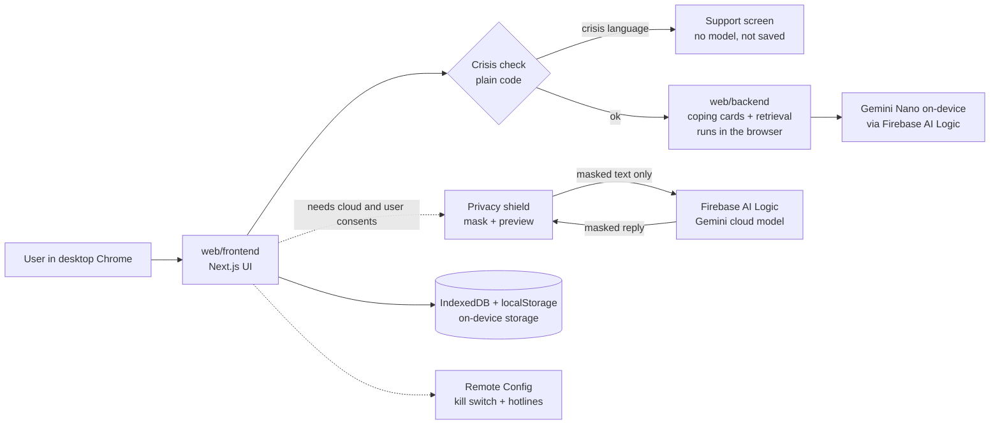

# Haven

A privacy-first mental wellness companion for students and young adults dealing with stress and tough times. Built for the **#BuildHybridAI 2026** hackathon with **Firebase AI Logic**.

> Haven is a supportive companion, **not** therapy and **not** a diagnostic tool. It can't diagnose or treat anything. If you're in crisis, contact local emergency services or a crisis line.

## Why hybrid

Mental health conversations are some of the most personal things a person types. Haven's design:

- **On-device by default.** Chat runs on Gemini Nano in Chrome (Prompt API) through Firebase AI Logic, so everyday messages never leave the computer.
- **Cloud only with consent, one use at a time.** Insights, Small steps, the message drafter, and chat on devices that can't run the private model can use a cloud Gemini model, after you say yes.
- **Privacy shield.** Before anything goes to the cloud, personal details (names, places, schools, employers, emails, phone numbers, links) are replaced with placeholders like `[PERSON_1]`. You see a side-by-side preview of exactly what the cloud will receive, can hide or show anything, and nothing is sent until you press **Send to cloud**. The reply is un-masked locally.
- **No server of our own.** Everything runs in the browser. Nothing about you is stored on a server, and there are no accounts.

## Features

| Feature | How it works |
| --- | --- |
| Opening agreement | Shown once, on a first visit, on every page. A welcome, a plain **"not a substitute for professional help"** disclaimer (not a doctor, therapist or counsellor; can't diagnose, treat or give medical advice; call emergency services or a crisis line if in danger) with a **Find a support line** button, a list of the features (what each does, **Private** or **Cloud**; the cards aren't links), and how privacy works. A **Turn on Chrome's on-device AI** step gives the address of the Chrome flag with a **Copy link** button (a web page can't open `chrome://` addresses) and four short steps; it shows "Your browser is ready" instead when the model is already switched on. Nothing else opens until the person ticks the agreement checkbox (and, if their browser isn't ready, "I've turned this on and restarted Chrome") and presses **Continue**. The choice is kept on this device only (not in backups) |
| Private chat | Gemini Nano on-device, with streaming replies. Two reply modes: **Just listen** (default: 2 to 4 sentences that reflect what you said, with no advice; a question on every other reply, and a gentle invitation to say more in between) and **Help me think** (asks what you've tried, then offers at most one idea). A clear ask like "what should I do" switches to Help for that one reply, and after a few listening turns Haven asks once whether you want ideas |
| Memory | A structured rolling summary (going on, feeling, tried, helped, open threads), the last 8 messages, and your "About me" notes. After 6 hours or more away, Haven knows how long it's been and can ask how an open thread turned out, only after you write first. Haven only brings up your notes or earlier events when your message is about them. It can also suggest one lasting fact ("Remember: exam on Friday?") with **Keep** / **Not now**; nothing is saved without Keep, and health details are never suggested. All of this runs on-device |
| Coping cards (RAG) | 92 short self-help cards, matched to your message by on-device keyword retrieval and added to the prompt in Help mode only. Cards used in recent replies, and techniques you said you already tried, are skipped. Replies that came from the cloud carry a "Cloud · you agreed" tag beside the bubble |
| Crisis safety | Rule-based check before **any** model call. On self-harm language: no model runs, the text isn't saved, and a full-screen support view appears. Type where you are (or pick a country) to see an emergency number and crisis lines for 200+ countries and territories |
| Privacy shield | Regex + on-device model detect personal details; preview dialog with tap-to-hide / tap-to-show; local un-masking; weaker-detection warning when the private model is unavailable |
| Consent and fallback | If the private model can't run: "Your device can't run the private model. Send this message to the cloud instead?" then the shield preview. A status badge always shows where work is running |
| Journal | A board of sticky notes. Press **New note** or click any empty spot on the board to open a popup: rate how you feel 1 to 10, write, and choose a paper colour (a new note is dated today automatically) (colour never means mood). Click a note to read it and edit it right there in a bordered text box (a Save button appears once you change something, and a quiet link lets you change the mood or colour), or delete it. Notes are saved only on this device and no AI reads them unless you ask. Language that suggests self-harm is never sent anywhere: Haven shows the support screen first, and you choose whether to keep that entry privately |
| Insights | One page that replaces the weekly reflection and journal insights. Pick **Last 7 days** or **Last 30 days**, and whether to look at your **journal notes**, your **chats**, or both. You see every note and chat item in that range, all included, as plain cards; a soft check circle in each card's corner chooses whether it is sent, and clicking the card opens its full text. No checkboxes and no coloured cards, so the page stays calm. The page uses the whole width, with the title and choices centred: your journal notes and chats side by side, with a panel beside them holding the word meter, **Get insights** and the result (on a phone it stacks, with the button in a bar at the bottom). Journal notes with self-harm language are shown as locked and are never sent. The ticked items (grouped by day, up to 900 words, with chat summaries first so 30 days fits; anything that doesn't fit is marked) go through the shield and a preview to the cloud model, which names the hardest and lighter days, recurring themes, patterns between your ratings and what you wrote, and a few small things to try, using the same coping cards as chat. Plain code (not the AI) adds a calm "talk to someone" note when your own ratings have been low. The result isn't saved |
| Small steps | A **4-week plan of longer-term activities**, built with you, in its own tab just left of Settings. **Private or Cloud:** you pick at the start (Private is the default, and your pick is remembered). **Private** writes everything on your device with Chrome's small model and sends nothing anywhere: it reads up to about 1,500 words of notes in slices of about 400 words (one on-device job per slice, then a job that joins the summaries, then one that writes the questions), and writes the plan as **four separate week jobs, one after another**, each knowing the earlier weeks' themes, each week appearing as soon as it is written. Plans are simpler than the cloud's. If the private model isn't downloaded yet, Get started downloads it (with a progress bar); if the browser can't run it, Private is greyed out and Cloud is chosen. A calm **loading animation** (three pulsing dots and a line like "Writing week 2 of 4…") shows while it works, and the plan says how it was made. **Cloud** works as follows. **1. Understand:** your journal, chats and **About me** notes from the last 7 or 30 days (up to 3,000 words, you choose which of the three) go through the shield and a preview to the cloud model, which writes a short summary (no names) and **3 to 5 questions** about your situation; Haven always adds two of its own (what you'd rather not do or be reminded of, and how much time you have). **2. Your answers:** every question is optional, and answers get the same crisis check as chat. **3. The plan:** the summary and your answers (not your notes again) go to the cloud through a second preview, and the plan is **written live on screen**: four weeks, two or three activities each, each with what it is, why it might help you, a concrete first step and how often. It's grounded in a **researched library of 49 plan ideas** from NHS, university counselling pages and other credible sources, each linked in [docs/plan-ideas.md](docs/plan-ideas.md), matched on your device. It never suggests anything tied to what's hurting or to something you said you'd rather avoid, never mentions medication, therapy or treatment, and sets no goals, streaks or reminders. It ends with a line about talking to a counselor or doctor if things feel the same or heavier, and a **Find a support line** button. The latest plan is kept on this device only, with **Make a new plan** and **Delete plan**, and is included in backups |
| Message drafter | Describe who and what; the cloud drafts a message (through the shield) that you can edit |
| Settings | Light by default; Dark mode, the text size (**Smaller** by default, Normal or Larger) and the font (Default, System, Nunito, Atkinson Hyperlegible or Serif) are manual choices, saved on this device. Smaller shrinks the text and spacing together, to about 15px body text. The fonts are bundled, so nothing is fetched while you use Haven. The Data & privacy tools live here too |
| Your data (in Settings) | "Download my data" (`haven-backup.json`), "Restore from file" (validated), "Clear app cache" (temporary data only, chats kept), "Delete everything", and a plain-language "How Haven handles your data" page |
| Remote Config | A cloud kill switch (`cloud_enabled`) and updatable hotline list (`hotlines_json`), with local defaults |

## Design principles

These are design choices, not health claims. Haven has not been user-tested, and nothing here is intended to treat or measure anything physiological.

- **Calm and easy when someone is overwhelmed.** The target is a person who is tired and finds it hard to concentrate. The UI never labels users or assumes a condition.
- **Soft colours, firm contrast.** A muted palette (sage green, dusty blue, warm sand, soft peach on a warm off-white) with gentle, non-vivid colours. Every text and background pair keeps at least 4.5:1 contrast (WCAG AA) in light and dark, and a test enforces it. Body text is 17px, with Smaller (about 15px) and Larger options.
- **Light by default.** Dark mode is a manual choice in Settings, not tied to the system setting.
- **No pressure.** No streaks, "you missed a day" nudges, red badges, countdowns or confetti. The journal has no reminders, goals or mood chart, and the 1 to 10 score is the person's own number, never interpreted as a measurement. Motion is limited to a small typing indicator that respects reduced-motion settings.
- **Plain, warm words.** No exclamation marks, forced cheer or guilt. Haven's replies follow a set order: validate and normalize the feeling, gently warn about consequences if something risky is mentioned, offer soft suggestions, then ask caring questions.
- **The crisis screen is calm but blunt.** Same palette, but large type, plain words and high contrast, with no alarm red or flashing.

## Architecture



## Repo layout

```
docs/                plan, hackathon checklist, Remote Config notes
tools/hotlines/      build-time scraper that generates the hotline data
LICENSE              Apache-2.0
web/                 npm workspaces root
  frontend/          Next.js 16 (App Router, TypeScript, Tailwind): UI, Firebase AI Logic, storage, shield flow
    app/<route>/     each page's code, plus components used only by that page
    components/      shared pieces (shell, providers, dialogs, Button/Input in ui.tsx)
    lib/             logic: AI, storage, prompt builder, shield, data tools
  backend/           @haven/backend: coping cards + retrieval, crisis rules, hotlines, shield masking, backup validation
```

`web/backend` is deliberately **not** a server. It's a pure TypeScript package imported by the frontend and run in the browser: retrieval takes your chat message, so it must never leave the device.

## How Firebase AI Logic is used

All AI inference goes through the Firebase AI Logic SDK (`firebase/ai`). See [web/frontend/lib/ai.ts](web/frontend/lib/ai.ts):

- `chatModel`: `InferenceMode.ONLY_ON_DEVICE`, daily chat (streaming via `generateContentStream`)
- `summaryModel`: `ONLY_ON_DEVICE`, rolling summaries and personal-detail detection
- `cloudModel`: `InferenceMode.ONLY_IN_CLOUD`, used only after consent and the shield preview (default `gemini-3.5-flash-lite`, no billing required)
- Randomness (temperature and topK) is set in [web/frontend/lib/sampling.ts](web/frontend/lib/sampling.ts): warm and varied for chat, steady for summaries, moderate for the cloud. For the on-device model it is read from Chrome's `LanguageModel.params()`, clamped to Chrome's limits, and dropped automatically (back to Chrome's defaults) if Chrome refuses it
- `initLocalModel(onProgress)` calls `initializeDeviceModel()` from the **Start chatting** click and drives the progress bar
- 503s are retried with exponential backoff; 429s and "model unavailable" show friendly messages

Setup (App Check, `GoogleAIBackend`) is in [web/frontend/lib/firebase.ts](web/frontend/lib/firebase.ts); Remote Config is in [web/frontend/lib/remoteConfig.ts](web/frontend/lib/remoteConfig.ts). No Firestore, Authentication, or other server-side Firebase product is used, and the free Spark plan is enough.

## Setup

### Requirements
- Node.js 20+ and npm
- **Desktop Chrome 139 or newer** (on-device inference needs desktop Chrome; phones aren't supported)
- A few GB of free disk space for Gemini Nano
- A Firebase project on the free Spark plan

### 1. Enable Chrome's on-device model
1. Open `chrome://flags/#prompt-api-for-gemini-nano-multimodal-input` and set it to **Enabled**.
2. Some Chrome versions also list it as "Gemma 4 for Built-in AI" in `chrome://flags` (not confirmed by the Firebase docs; try it if the flag above isn't enough).
3. **Restart Chrome.**
4. Check the model at `chrome://on-device-internals`.

### 2. Firebase project
1. Create a Firebase project and register a **Web app** (Project settings > Your apps).
2. Open **Build > AI Logic**, click Get started, and choose the **Gemini Developer API** (free tier).
3. Copy the web app config into `web/frontend/.env.local`:
   ```bash
   cp web/frontend/.env.example web/frontend/.env.local
   ```
   Fill in the `NEXT_PUBLIC_FIREBASE_*` values (public web config, not secrets). **Never commit `.env.local`**; it's gitignored.

### 3. App Check debug token (local development)
Firebase AI Logic requests are protected by App Check. On localhost Haven uses the **debug provider**:
1. Run the app (below) and open the browser console. You'll see `Firebase App Check debug token: <uuid>`.
2. In the Firebase console go to **Build > App Check > Apps**, open the ⋮ menu on your web app, choose **Manage debug tokens**, and add the token.
3. Optional: put the token in `NEXT_PUBLIC_APP_CHECK_DEBUG_TOKEN` in `.env.local` so it stays stable across reloads and cleared site data.

The token is never hardcoded or committed. This build is **localhost-only**; a deployed version would need a production App Check provider.

### 4. Run it
```bash
cd web
npm install
npm run dev
```
Open http://localhost:3000 and click **Start chatting** (the first run downloads Gemini Nano, which can take several minutes; it only happens once).

Other commands, from `web/`: `npm run build`, `npm run lint`, `npm run typecheck`, `npm test`, `npm run format` (Prettier with Tailwind class sorting) and `npm run format:check`.

### Optional: Remote Config
Publish these parameters in Firebase console > Remote Config to control a running app (details in [docs/remote-config.md](docs/remote-config.md)):
- `cloud_enabled` (boolean): turn off all cloud features instantly
- `hotlines_json` (string): replace the hotline list without redeploying

### Optional: Firebase agent skills
For AI coding agents working on this repo:
```bash
claude plugin marketplace add firebase/agent-skills
claude plugin install firebase@firebase
```

## Tests

`npm test` from `web/` runs 477 Vitest tests, with the Firebase AI calls mocked:
- crisis detection (flags crisis phrases, ignores everyday language, and proves no model is called)
- prompt builder structure and length budget
- retrieval scoring
- shield mask / un-mask round trip, including graceful failure on altered placeholders
- backup export / import validation
- hotline data integrity, location matching and tap-to-call parsing
- sticky-note paper colours: every note colour keeps 4.5:1 contrast for its text in light and dark, and backups accept only known colours
- reply guardrails: a copied "Haven:" label, pet names and an "Oh" opener are removed, and replies over the mode's sentence limit (4 in Listen, 6 in Help) are cut from the middle, keeping the opening and the closing question; the same applies to cloud replies
- chat style: help-intent detection, the offer-once rule, the structured summary parser, "last talked" gaps, memory vetting (no health, crisis, duplicate or declined facts), modes and cards in the prompt, the shrink-and-retry, and extraction never running on crisis text or in the cloud
- journal: entry validation and backup v2 validation (moods, days, v1 files still load), and the IndexedDB upgrade keeping existing chats
- Small steps, private: slicing notes (about 400 words, nothing lost), the slice, combine, question and per-week jobs run in order with a fake on-device model, each week seeing the earlier themes, one retry then plain text, a week left out when empty, stopping between jobs, and the saved plan's mode (old plans read as having none).
- Small steps: reading the first reply (summary and 3 to 5 questions, with a generic fallback), the two fixed questions, the answers text, the crisis check on answers, reading a 4-week plan into weeks and activities (and falling back to plain text), the saved plan (round trip, old plans still read, damaged data ignored, fits a backup), gathering with each source on and off up to 3,000 words, crisis language never included (not in journal notes and not in an About me note), and the two instructions (never contain your words, no medication, therapy or treatment, no goals, nothing tied to what hurts)
- the plan-ideas library: every idea sourced and dated, six or more per situation, three or more publishers, nothing clinical, no goals or tracking, and matching real notes to the right situation
- streaming: names are restored as a reply arrives and a half-written placeholder is never shown
- Insights word meter: the numbers as text, the bar, "won't fit" and left-out notes
- Insights: listing every item and choosing which to send (unselected items never appear, nothing selected sends nothing, locked crisis notes carry no text, items that don't fit are reported), gathering for journal only, chats only and both (the 60/40 split, summaries before messages, 30 days within the budget), the instruction (never contains your words, safety lines, cards only when found), and the low-mood note
- palette contrast: every text/background pair stays at 4.5:1 or better in light and dark, and the theme is light by default

## How changes reach the live site

The site at https://haven-882c1.web.app is built and uploaded by GitHub Actions. Nobody pushes straight to `main`: every change goes through a pull request.

1. Make a branch and open a pull request.
2. Two checks run (`.github/workflows/ci.yml`, with made-up settings, so no secret is involved):
   - **Lint, format, typecheck and tests:** `npm run lint`, `npm run format:check`, `npm run typecheck`, `npm test`.
   - **Build and safety checks:** the production build, then `tools/ci/check-build-output.mjs`, which fails if a debug token or text from the developer pages (`/debug`, `/dev/prompt`) is in the built files.
3. A preview of the built site is uploaded to a temporary address, shown on the pull request. Cloud features don't work there (reCAPTCHA only trusts the real domains). Pull requests from forks get no preview and no secrets.
4. Both checks must pass before the pull request can be squash-merged.
5. Merging to `main` runs the same checks again, builds with the real settings (kept as GitHub secrets, because `.env.local` is not in the repo) and uploads to the live site.

Dependabot opens a pull request when a pinned action or a vulnerable package needs an update, and CodeQL scans the code for security mistakes.

## Privacy model

- **Stays on your device:** chats, summaries, journal entries and mood ratings, notes and settings; all everyday inference.
- **Can go to the cloud, only when you choose:** masked text for a chat message (only if the private model can't run), Insights, Small steps, and the message drafter. Requests pass through Google's Firebase AI Logic to a Gemini model, so Google processes the masked text under its terms. Haven keeps no copy.
- **Never sent to any AI:** messages containing self-harm language. In chat they aren't saved either. In the journal you can keep such an entry privately on your device; it is excluded from Insights and Small steps.
- Details on the in-app page: **Settings > Data & privacy**.

## Limitations and safety notes

- Not a substitute for professional care. Haven can't diagnose or treat.
- **Hotline numbers were scraped from Wikipedia** at build time (see [tools/hotlines](tools/hotlines/README.md)), covering 202 countries and territories as of the date in `hotlines.json`. They can be out of date or incomplete, the crisis screen says so, and a human should spot-check the ones that matter before real use.
- **Coping cards are not clinically reviewed.** They're written as general, non-clinical techniques, and none has been reviewed by a professional (`reviewed: false` on all 92). On 2026-11-16 the advice in 64 of them was compared with a credible page (mostly NHS, plus NIMH, CDC, Cleveland Clinic, Samaritans and university counselling centres), the cited link is saved on the card with a `sourceChecked` date, and 18 were reworded to remove absolute or unsourced claims. The other 28 have no verified source yet (`TODO: verify against source`) and need checking by a person.
- **The plan-ideas library is not clinically reviewed** (`reviewed: false` on all 49). Each idea was written from a public page, then re-checked against that page by independent checkers who found 42 of the 53 first drafts overstated what the page said and had them corrected (details in [docs/plan-ideas.md](docs/plan-ideas.md)). The source mix leans on the NHS and university counselling pages because Mind, the Mental Health Foundation and others blocked the automated checks. Some sources are written for other audiences. A person should review it before real use.
- Small steps does no live web search: a browser-only app can't read other sites, and Google Search grounding through Firebase AI Logic is not available on the free tier. Plans rest on the library, the person's own words, and the cloud model's own knowledge, and can be wrong.
- Crisis detection is a broad keyword list, so it can miss unusual phrasing and sometimes over-trigger.
- Retrieval is lightweight keyword matching (no embeddings), so it matches words, not meaning.
- Personal-detail detection isn't perfect, which is why you review the preview. Without the on-device model it only finds emails, phone numbers and links automatically.
- On-device inference supports single-turn text only, so conversation memory is built into each prompt by the app. Suggested memories and "last talked" use the same small model, so they can miss things or occasionally suggest something odd, which is why you press Keep.
- The small on-device model doesn't always follow its instructions, so plain-code guardrails clean and shorten replies after the fact. It can still be flat or miss nuance, which is the trade-off for keeping everyday chat on the device.
- Developer page `/dev/prompt` shows the exact prompt sent to the on-device model; it is hidden in production builds.
- Localhost-only demo with App Check debug tokens. Desktop Chrome required for the private model.

## License

[Apache-2.0](LICENSE)
